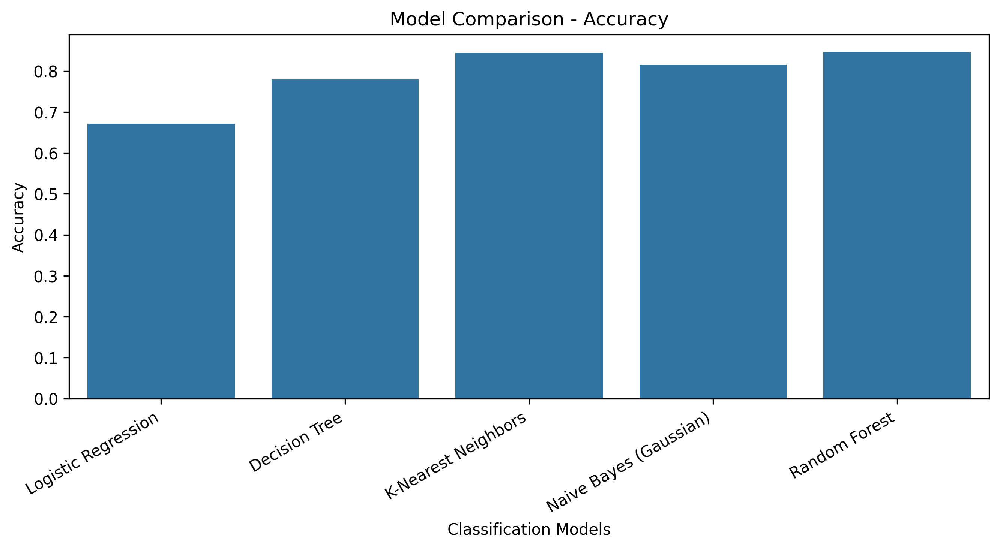
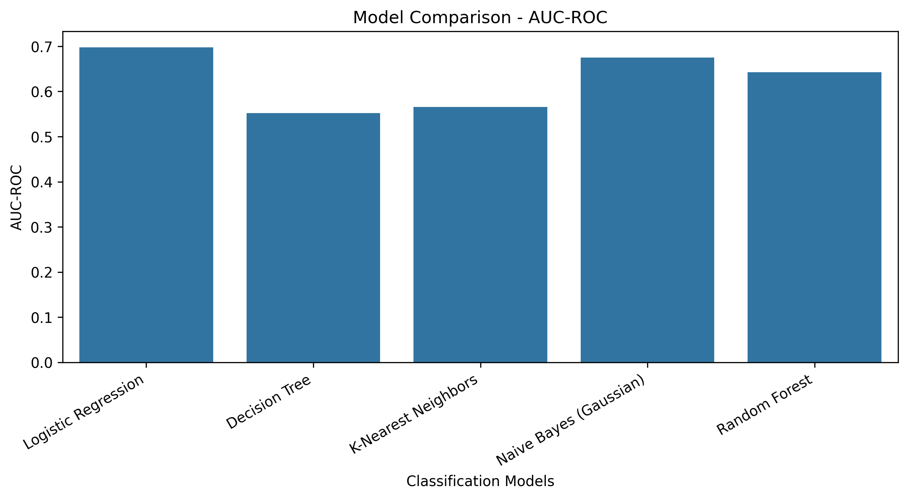
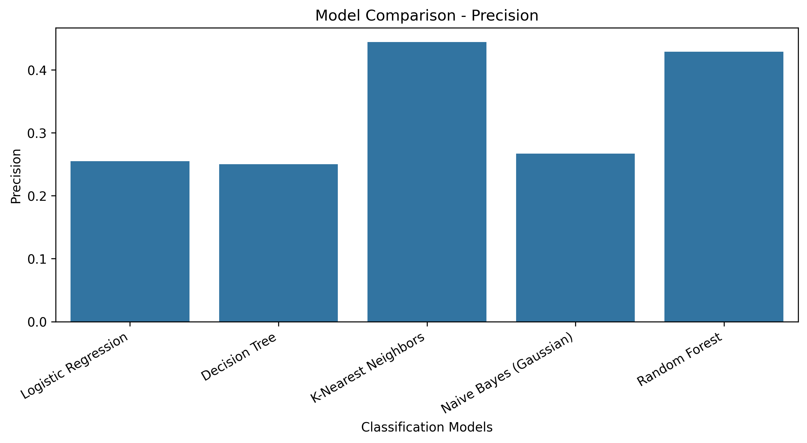
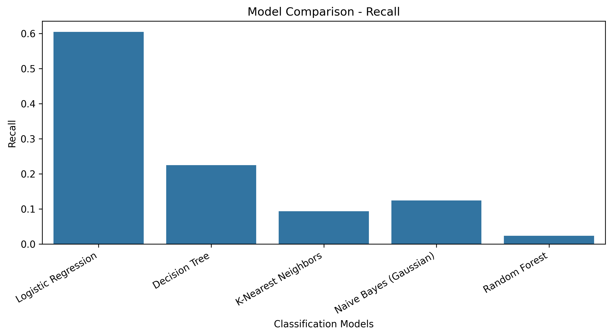
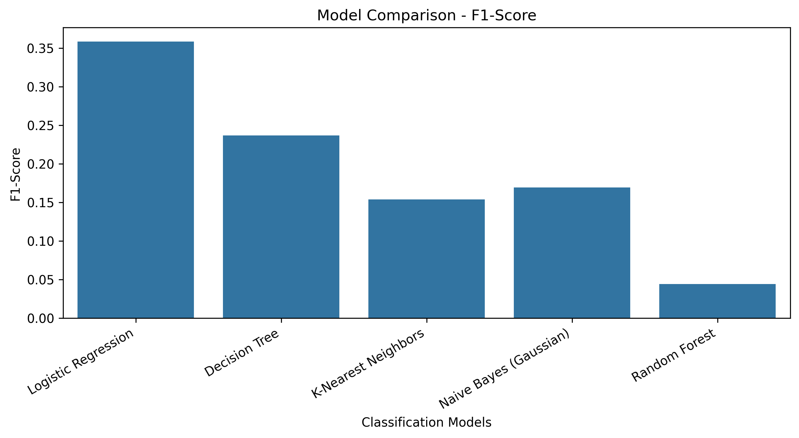
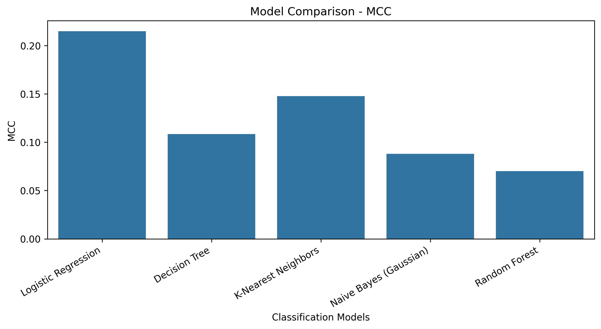
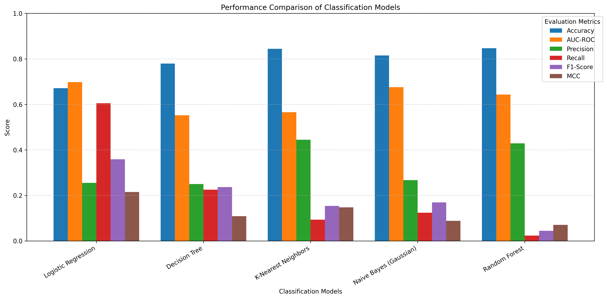
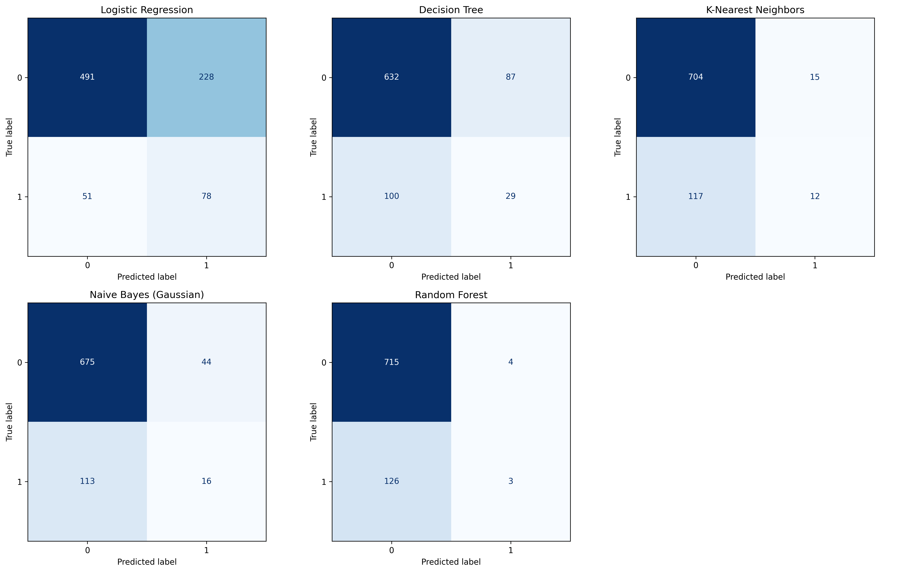

# Framingham Heart Disease Classification

## 1. Problem Statement

Heart disease is one of the major health concerns worldwide. Early identification
of individuals who may be at risk of developing Coronary Heart Disease (CHD)
can help support timely medical assessment and preventive care.

The objective of this project is to develop and compare machine learning
classification models to predict whether an individual is likely to develop
Coronary Heart Disease within the next ten years based on demographic,
behavioral, and medical attributes.

This is a binary classification problem:

- 0: Individual did not develop CHD within ten years.
- 1: Individual developed CHD within ten years.

Recall is considered the primary evaluation metric because identifying actual
positive cases is important, and False Negative predictions may result in
potentially at-risk individuals being overlooked.

## 2. Dataset Description

**Dataset Name:** Framingham Heart Disease Dataset

| Dataset Attribute | Description |
|---|---|
| Total Instances | 4,240 |
| Input Features | 15 |
| Total Columns | 16 |
| Target Variable | TenYearCHD |
| Missing Values | 645 |
| Duplicate Records | 0 |
| Problem Type | Binary Classification |

### Input Features

1. male
2. age
3. education
4. currentSmoker
5. cigsPerDay
6. BPMeds
7. prevalentStroke
8. prevalentHyp
9. diabetes
10. totChol
11. sysBP
12. diaBP
13. BMI
14. heartRate
15. glucose

**Target Variable:** TenYearCHD

### Class Distribution

| Class | Description | Records | Percentage |
|---|---|---:|---:|
| 0 | No CHD within ten years | 3,596 | 84.81% |
| 1 | CHD within ten years | 644 | 15.19% |

The dataset has an imbalanced class distribution, with more negative
cases than positive cases.

### Data Preprocessing

The following preprocessing steps were performed:

- Missing numerical values were handled using median imputation.
- Missing categorical values were handled using most-frequent imputation.
- Categorical features were encoded using One-Hot Encoding.
- Numerical features were standardized using StandardScaler.
- The dataset was divided into 80% training data and 20% testing data.
- Stratified splitting was used to preserve class distribution.
- Preprocessing transformations were fitted only on training data to
  prevent data leakage.

## 3. GitHub Repository Link

**GitHub Repository:** https://github.com/2026ct05089/2026CT05089_ML_Assignment2

The repository contains the Jupyter Notebook, saved trained models,
preprocessing object, test dataset, evaluation results, visualizations,
and README file.

## 4. Models Used and Performance Comparison

Five machine learning classification algorithms were implemented:

1. Logistic Regression
2. Decision Tree
3. K-Nearest Neighbors (kNN)
4. Gaussian Naive Bayes
5. Random Forest (Ensemble)

### Model Comparison Table

| ML Model Name | Accuracy | AUC | Precision | Recall | F1 | MCC |
|---|---:|---:|---:|---:|---:|---:|
| Logistic Regression | 0.6710 | 0.6981 | 0.2549 | 0.6047 | 0.3586 | 0.2150 |
| Decision Tree | 0.7795 | 0.5519 | 0.2500 | 0.2248 | 0.2367 | 0.1085 |
| kNN | 0.8443 | 0.5655 | 0.4444 | 0.0930 | 0.1538 | 0.1476 |
| Naive Bayes | 0.8149 | 0.6754 | 0.2667 | 0.1240 | 0.1693 | 0.0880 |
| Random Forest (Ensemble) | 0.8467 | 0.6430 | 0.4286 | 0.0233 | 0.0441 | 0.0702 |

### Graphical Representation of Evaluation Metrics

**Accuracy Comparison**

**AUC-ROC Comparison**

**Precision Comparison**

**Recall Comparison**

**F1-Score Comparison**

**MCC Comparison**

**Performance Comparison of Classification Models**

### Confusion Matrix Comparison

### ML Model Name and Observation about Model Performance [3 Marks]

| **ML Model Name** | **Observation about model performance** |
|---|---|
| Logistic Regression | Achieved the highest recall (0.6047), AUC (0.6981), F1-score (0.3586), and MCC (0.2150). It identified more actual CHD cases than the other models, making it the preferred model for this assignment. |
| Decision Tree | Achieved an accuracy of 0.7795 but had a relatively low recall of 0.2248, indicating that it missed many actual CHD cases. |
| K-Nearest Neighbors (KNN) | Achieved the highest precision (0.4444) and an accuracy of 0.8443, but its recall was only 0.0930, meaning it identified very few actual CHD cases. |
| Gaussian Naive Bayes | Achieved an AUC of 0.6754, the second-highest among the models. However, its recall of 0.1240 indicates limited ability to identify positive CHD cases. |
| Random Forest (Ensemble) | Achieved the highest accuracy (0.8467), but its recall was only 0.0233. It missed almost all actual CHD cases, making it unsuitable when recall is the primary evaluation metric. |
| **Overall Winner – Logistic Regression** | **Selected as the overall winner because it achieved the highest recall (0.6047), which is the primary evaluation metric for this classification problem.** |

## 6. Overall Winner for the Dataset

**Selected Model: Logistic Regression**

Logistic Regression was selected as the overall preferred model because
Recall was the primary evaluation metric for this classification problem.

It achieved a Recall of 60.47%, outperforming all other models in
identifying actual positive CHD cases. It also achieved the highest
AUC-ROC, F1-score, and MCC.

Although Random Forest achieved the highest Accuracy of 84.67%, its
Recall was only 2.33%. This demonstrates that accuracy alone is not
sufficient for evaluating an imbalanced classification problem.

Therefore, Logistic Regression was selected as the most suitable model
based on the primary objective of identifying positive CHD cases.

**Conclusion:** Logistic Regression provided the best overall balance
according to the selected evaluation criteria, particularly Recall.
However, its relatively low Precision indicates that further improvement
would be necessary before considering any real-world application.

*Note: This is an academic machine learning project. Its predictions are
not intended to replace professional medical assessment or diagnosis.*
